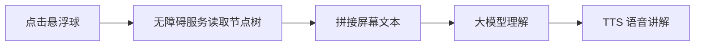
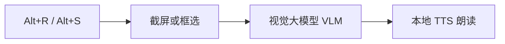

<div align="center">

# 万物皆可读 · Read Anything

**不是"念字"，而是 AI 看懂屏幕后，像朋友一样讲给你听。**

[](https://www.python.org/)
[](https://developer.android.com/)
[](https://kotlinlang.org/)
[](https://github.com/dhc979917-ux/read-anything)

*A screen-reading assistant that actually **understands** what's on your screen — and tells you, out loud, in plain language.*

</div>

---

## 这是什么

一个给**视障用户**、**视疲劳人群**和"懒得看字的人"的屏幕理解助手。

现有的读屏工具（NVDA、TalkBack）和 OCR 朗读工具做的都是**逐字念屏幕**；本项目把屏幕内容交给大语言模型，让它**理解之后讲解**：

> 屏幕上是一张购物订单页，你在"待发货"列表里有一单昨天 21:47 下的单，商品是蓝牙耳机，金额 199 元，页面底部有个"查看物流"按钮，如果你想看物流信息，点它就行。

一个 Demo 级 MVP，包含**两个平台实现**：

| 版本 | 技术栈 | 获取屏幕内容的方式 | 状态 |
|---|---|---|---|
| **Windows 桌面版** | Python + mss + VLM + pyttsx3 | 截屏 → 视觉大模型（**连图表、图片都能读**） | ✅ 可运行 |
| **Android 版** | Kotlin + AccessibilityService + LLM + TTS | 无障碍节点树 → 文本 → LLM | ✅ 可运行 |

## 效果演示

> 📷 贡献欢迎：录一段 GIF 放到 `docs/` 下替换本节，比一百句话都有说服力。

（占位：Android 悬浮球点击 → 语音讲解截图 / Windows Alt+R 朗读视频）

## 工作原理

**Android 版**：点悬浮球 → 无障碍服务抓取当前屏幕的文本节点 → 发给任意 OpenAI 兼容的大模型 → 用系统 TTS 中文朗读讲解。



**Windows 版**：全局热键截屏 → 直接把**图片**发给视觉大模型（VLM）→ 朗读。因为 AI 看到的是画面本身，图表、图标、视频画面都能描述。



## 快速开始

### Android 版

1. 用 Android Studio 新建 `Empty Views Activity` 项目（包名必须为 `com.example.myreaderdemo`）
2. 把新项目文件夹拖到 **`一键拷贝到AndroidStudio项目.bat`** 上，自动拷入代码
3. 手机开 USB 调试、插线，点绿色 ▶ 运行
4. App 内：**AI 设置**选服务商填密钥 → 开启无障碍服务 → 开悬浮球 → 去任意 App 点球听讲解

### Windows 版

```bash
# 建议建虚拟环境后执行
pip install -r requirements.txt
```

1. 用记事本打开 `config.json`，填入 `api_key`（默认智谱 `glm-4v-flash`，免费）
2. 双击 `启动.bat`

| 热键 | 作用 |
|---|---|
| `Alt + R` | AI 理解整个屏幕并朗读 |
| `Alt + S` | 框选一块区域朗读（图表/图片/视频画面均可） |
| `Alt + Q` | 停止朗读 |

## 支持的 AI 服务商

Android 版在 App 内「AI 设置」里选预设即可，随时切换、无需重新编译；Windows 版改 `config.json`。所有走 OpenAI 兼容协议的服务都能用：

| 服务商 | 接口地址 | 推荐模型 | 密钥 | 备注 |
|---|---|---|---|---|
| 智谱 AI | `https://open.bigmodel.cn/api/paas/v4` | `glm-4-flash` | 需要 | **有免费模型，推荐起步** |
| 通义千问 | `https://dashscope.aliyuncs.com/compatible-mode/v1` | `qwen-plus` | 需要 | 阿里云 |
| DeepSeek | `https://api.deepseek.com` | `deepseek-chat` | 需要 | |
| Kimi | `https://api.moonshot.cn/v1` | `moonshot-v1-8k` | 需要 | |
| OpenAI | `https://api.openai.com/v1` | `gpt-4o-mini` | 需要 | 国内网络需代理 |
| Ollama 本地 | `http://<电脑IP>:11434/v1` | `qwen2.5:7b` | **不需要** | 完全离线，隐私最佳 |

> 🔐 **隐私提示**：除本地模型外，屏幕内容会发送到所配置的云端服务商。正式产品需要做脱敏、本地模型或用户授权处理，当前 Demo 未做。

## 和现有工具的差异

| 工具 | 逐字念 | 理解讲解 | 能读图片图表 | 平台 |
|---|---|---|---|---|
| 系统读屏（NVDA / TalkBack） | ✅ | ❌ | ❌ | 桌面 / Android |
| OCR 朗读工具（read-screen 等） | ✅ | ❌ | ❌ | 各平台 |
| **万物皆可读** | ✅ | ✅ LLM 生成口语讲解 | ✅（Windows 版 VLM） | Windows / Android |

调研过的同类先例见[参考项目](#参考项目)。

## 项目结构

```
├── read_screen.py            # Windows 版主程序（截屏 → VLM → 朗读）
├── config.json               # Windows 版 AI 配置
├── 启动.bat                   # Windows 版一键启动
├── 一键拷贝到AndroidStudio项目.bat  # Android 版代码导入脚本
└── MyReaderDemo/             # Android 版
    └── app/src/main/
        ├── AndroidManifest.xml
        ├── java/com/example/myreaderdemo/
        │   ├── MainActivity.kt       # 主界面 + 悬浮球 + 朗读流程
        │   ├── ReaderService.kt      # 无障碍服务：读取屏幕节点
        │   ├── AiClient.kt           # OpenAI 兼容 API 客户端
        │   ├── AiConfig.kt           # AI 配置持久化
        │   ├── AiSettingsDialog.kt   # App 内换模型/填密钥弹窗
        │   └── TtsHelper.kt          # TTS 封装
        └── res/                      # 布局与无障碍服务配置
```

## 路线图

- [ ] Android 版支持截屏 + 视觉模型（当前只读文字节点，看不了图片）
- [ ] Windows 版换 edge-tts 自然人声（当前 pyttsx3 音色较机械）
- [ ] 悬浮球长按菜单：停止 / 重读 / 切换模式
- [ ] 连续朗读模式：页面内容变化时自动重读
- [ ] 本地小模型离线兜底（无网也能用）
- [ ] 长屏幕内容智能截断与摘要

## 常见问题

<details>
<summary>国产手机开了无障碍，过一会儿悬浮球就失灵？</summary>

系统 battery optimization 杀了后台。设置 → 电池 → 应用启动管理，把本应用设为"手动管理"并允许后台运行。
</details>

<details>
<summary>点了悬浮球没声音？</summary>

检查 设置 → 辅助功能 → 文本转语音（TTS），确认安装了中文语音包；模拟器自带的 Google TTS 常缺中文，建议真机测试。
</details>

<details>
<summary>提示"AI 调用失败"？</summary>

多半是密钥错误或网络不通。国内网络建议选智谱/DeepSeek 预设；OpenAI 需要代理。错误信息会通过语音读出来，方便排查。
</details>

<details>
<summary>Windows 版报"识别失败"？</summary>

检查 `config.json` 的 `api_key` 是否已填写、网络能否访问所配服务商。
</details>

## 参考项目

本项目立项前调研过的同类开源项目，感谢先行者们：

- [read-screen](https://github.com/wangz-code/read-screen) / [screen-speak](https://github.com/Lekonidus/screen-speak) — 框选屏幕 OCR + 本地 TTS 朗读
- [ScreenGPT-OCR](https://github.com/Chiwai15/ScreenGPT-OCR) — 截图 + GPT-4o 理解 + TTS 的早期尝试
- [UGTLive](https://github.com/SethRobinson/UGTLive) — 屏幕实时翻译与朗读，工程完整度标杆
- [overlay-translator](https://github.com/ciddwd/overlay-translator) — Android 屏幕实时翻译（980 star），验证了需求

## 许可证

待定（建议 MIT，欢迎提建议）。

---

<div align="center">

**如果这个项目对你有帮助，欢迎点一个 Star ⭐**

</div>
