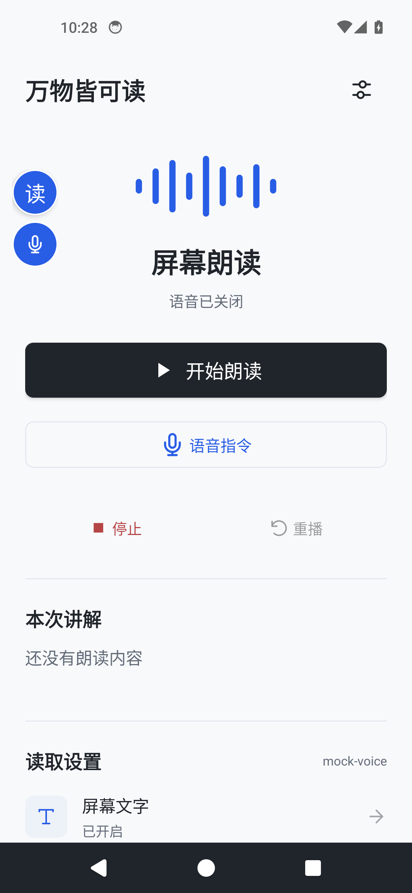
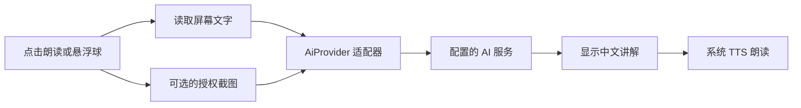

<div align="center">

# 万物皆可读

**让屏幕上的文字与画面，变成可以听见的讲解。**

read-anything · AI 屏幕理解与朗读工具


[界面预览](#preview) · [安装使用](#quick-start) · [模型接入](#providers) · [开发指南](#development) · [验证记录](MyReaderApp/VALIDATION.md)

</div>

---

万物皆可读将屏幕文字与可选截图交给配置的 AI 模型，生成中文讲解，再通过系统语音引擎朗读。项目面向需要语音获取屏幕信息的用户，包含 **Android 应用**与 **Windows 桌面脚本**。

> **当前阶段：0.3 可安装测试版。** 已加入语音指令和页面导航，通过模拟器回归；真实语音识别、模型理解效果、中文发声及手机后台稳定性仍需真机验收。

<a id="preview"></a>

## 界面预览

<p align="center">
  
  &nbsp;&nbsp;
  
</p>

<p align="center"><sub>Android 14 模拟器实拍 · 朗读首页与模型选择（模拟列表）</sub></p>

### 核心体验

| 功能 | 当前实现 |
| :--- | :--- |
| **获取屏幕内容** | 无障碍服务读取界面文字，按需授权截图 |
| **理解与讲解** | 将内容发送至配置的模型，在页面显示返回的讲解 |
| **语音与控制** | 中文语音口令、指定区域与朗读方式、语速调整、停止与重播 |
| **跨应用入口** | 可拖动的朗读与麦克风按钮；请求中显示加载环，再点停止 |
| **页面导航** | 按口令滑动、返回、回桌面、最近应用、打开应用；按名称点击前确认 |
| **模型配置** | 实时获取模型列表、搜索选择、手动模型 ID、独立服务配置与连接测试 |

<a id="quick-start"></a>

## 安装使用

### Android：安装测试包

**[获取测试 APK](MyReaderApp/validation/MyReader-debug.apk)** · [完整运行说明](MyReaderApp/TESTING.md)

1. 将 APK 通过 USB 或文件传输工具发送到安卓手机。
2. 在手机文件管理中打开 APK，按系统提示允许安装并完成安装。
3. 打开「万物皆可读」，点击右上角的**模型设置**，选择服务并填写密钥，点击**获取模型**后搜索选择，测试连接后保存。
4. 在首页的**读取设置**中开启「屏幕文字」；需要图片输入时，再授权「图片识别」。
5. 开启「悬浮朗读」，确认内容发送授权后，切换到目标页面点击悬浮球。

手机需配置支持中文的 TTS 语音引擎；语音输入另需可用的中文语音识别服务和麦克风权限。APK 仅适用于 Android，不适用于 iPhone；当前提供的是 debug 测试包。

### 语音使用

在首页或悬浮入口点击麦克风，首次确认语音数据说明并授权麦克风，听到提示音后说一个口令。录音只在语音窗口前台运行；返回或切换应用会停止录音。暂不支持后台持续监听或唤醒词。

| 口令示例 | 行为 |
| :--- | :--- |
| 读整个页面 / 总结一下 / 只读价格 | 按要求生成讲解 |
| 读上半部分 / 读下半部分 | 按屏幕区域筛选文字，并裁剪已授权的截图 |
| 读当前焦点 / 读这里 | 读取无障碍焦点或输入焦点，不向模型发送整屏截图 |
| 慢一点 / 快一点 / 再读一遍 / 停止朗读 | 调整后续播放语速、重播或停止 |
| 向上滑动 / 下一页 | 查看后面的内容 |
| 向下滑动 / 上一页 | 查看前面的内容 |
| 返回 / 回到桌面 / 最近应用 | 单步系统导航 |
| 打开微信 | 按手机中已安装应用的完整名称打开 |
| 点击按钮名称 → 确认执行 | 精确匹配可见控件，30 秒内确认且页面未变化才点击 |
| 取消 / 语音帮助 | 取消待执行操作，或播报口令说明 |

识别不清时可重试，或核对语音窗口中的文字后执行。同名按钮、已变化的页面和没有提供无障碍控件的页面不会猜测点击位置。模型只生成朗读内容，不决定或执行手机操作；当前没有自主完成多步任务的功能。

<details>
<summary><strong>Windows：运行桌面版</strong></summary>

在项目根目录打开 PowerShell，创建虚拟环境并安装依赖：

```powershell
py -m venv .venv
.\.venv\Scripts\python.exe -m pip install -r requirements.txt
```

编辑 `config.json`，填写 `base_url`、`api_key` 和支持图片输入的 `model`，然后双击 `启动.bat`。

| 默认快捷键 | 操作 |
| :--- | :--- |
| `Alt + R` | 截取整个屏幕并请求讲解 |
| `Alt + S` | 框选区域并请求讲解 |
| `Alt + Q` | 停止朗读 |

配置中的模型名称是预设值，不代表其当前可用性或价格。本轮测试未覆盖 Windows 版。

</details>

<a id="providers"></a>

## 模型接入

Android 内置 **4 类协议适配器、9 个服务预设**，模型不再局限于预设名称。

1. 选择服务商，填写 API 密钥与 API 根地址；Ollama 不需要密钥。
2. 点击 **获取模型**，从接口返回的列表搜索并选择模型，也可以直接填写模型 ID。
3. 根据模型的实际图片能力设置截图开关，点击 **测试连接**，成功后保存。

各服务商分别记住已保存的地址、密钥和模型。设置页内来回切换会保留未保存草稿；退出设置页后，未保存的修改不会生效。每个预设保存一组配置，「自定义」也只有一个配置位置。

「自定义」可选择 OpenAI 兼容、Claude、Gemini 或 Ollama 协议，适用于对应协议的代理或自建服务。地址应填写 API 根地址，例如带 `/v1` 的 OpenAI 地址，不要填写完整的 `/chat/completions` 路径。

| 适配器 | 配置入口 |
| :--- | :--- |
| **OpenAI 兼容** | OpenAI、通义千问、DeepSeek、智谱 GLM、Kimi、自定义 |
| **Claude** | Anthropic Claude、自定义 |
| **Gemini** | Google Gemini、自定义 |
| **Ollama** | Ollama 本地服务、自定义 |

模型列表来自当前地址与密钥对应的服务；不支持列表接口时仍可手动填写。OpenAI 兼容列表可能包含非聊天模型，出现在列表中不保证能用于本应用；当前 OpenAI 适配器使用 Chat Completions。Gemini 列表只保留声明支持 `generateContent` 的模型，Ollama 列出本地已安装模型。

模型名称、图片能力及服务地址以实际部署或账户配置为准。**文字连接测试成功，不代表图片识别也已验证**；使用纯文字模型时，请关闭「发送已授权的截图」。

<details>
<summary><strong>连接电脑上的 Ollama</strong></summary>

手机中的 `localhost` 指手机本身。电脑已运行 Ollama、手机已开启 USB 调试并连接电脑时，可运行：

```sh
adb reverse tcp:11434 tcp:11434
```

在应用中选择 Ollama，地址填写 `http://localhost:11434`，模型名填写电脑上已安装的模型。

Android 模拟器也可使用 `http://10.0.2.2:11434`。当前应用只对本机及模拟器主机地址放行 HTTP，其他地址需要 HTTPS。

</details>

<a id="development"></a>

## 开发指南

### 构建 Android 应用

环境要求：**JDK 17 · Android SDK 34 · Build Tools 34.0.0**。项目自带 Gradle 8.2 Wrapper，也可直接在 Android Studio 中打开 `MyReaderApp`。

通过 `ANDROID_HOME` 或本机 `local.properties` 的 `sdk.dir` 指定 SDK 路径，然后执行：

```sh
cd MyReaderApp
./gradlew :app:assembleDebug :app:lintDebug
```

Windows 使用 `gradlew.bat`。构建产物位于 `app/build/outputs/apk/debug/app-debug.apk`，可通过 ADB 安装：

```sh
adb install -r app/build/outputs/apk/debug/app-debug.apk
```

### 工作流程



业务层通过 `AiProvider` 调用模型；不同协议由各自的适配器处理。Windows 版使用「截屏 → 视觉模型 → 本地 TTS」流程。

### 目录导航

| 路径 | 内容 |
| :--- | :--- |
| [`MyReaderApp/`](MyReaderApp/) | 当前 Android 应用，包含界面、悬浮球与朗读流程 |
| [`MyReaderApp/app/src/main/java/com/example/myreader/ai/`](MyReaderApp/app/src/main/java/com/example/myreader/ai/) | 模型配置与协议适配器 |
| [`MyReaderApp/TESTING.md`](MyReaderApp/TESTING.md) | 构建、运行与验收步骤 |
| [`MyReaderApp/VALIDATION.md`](MyReaderApp/VALIDATION.md) | 实际测试结果与尚未验证的范围 |
| [`MyReaderDemo/`](MyReaderDemo/) | 早期 Android 原型，保留作参考 |
| [`read_screen.py`](read_screen.py) | Windows 截屏与朗读入口 |
| [`config.json`](config.json) | Windows 模型与快捷键配置 |

## 测试状态

以下为 **2026-10-11 的本地验证记录**，完整证据见 [VALIDATION.md](MyReaderApp/VALIDATION.md)。

| 验证范围 | 结果 |
| :--- | :--- |
| APK 构建与 Android Lint | 通过；0 个错误、61 个警告 |
| Android 14 安装、界面与配置入口 | 已验证 |
| 模型获取、搜索、切换保存与四种协议解析 | 已使用本地模拟接口验证 |
| 小屏幕、150% 字体与表单滚动 | 已验证 |
| 模拟接口返回、请求取消与 HTTP 401 | 已验证 |
| 连续截图与跨应用悬浮入口 | 已验证 |
| 语音朗读、滑动、返回、打开应用、确认点击与异常处理 | 17 项模拟器自动化检查通过；识别转录和 AI 响应为模拟数据 |
| 新版首页与语音窗口，小屏及150%字体 | 已检查；录音超时可恢复 |
| 真实语音识别、模型理解效果、中文发声与真机后台稳定性 | **待验证** |

接口测试使用本地模拟服务返回固定讲解；语音自动化注入模拟识别结果，不能据此评价语音识别率或 AI 的理解质量。复现步骤见 [TESTING.md](MyReaderApp/TESTING.md#语音自动化验证)。

## 数据与权限

- **内容去向**：点击朗读后，屏幕文字和可选截图会发送到配置的服务。Android 首次朗读需要确认发送授权。
- **截图控制**：图片识别单独授权，也可以在模型设置中关闭图片发送。
- **敏感内容**：密码节点不参与文字收集，但截图尚未自动脱敏，请避开敏感页面。
- **密钥存储**：Android 密钥保存在应用私有 SharedPreferences 中，尚未使用 Keystore 加密。
- **语音数据**：手机配置的语音识别服务可能使用云端识别；本应用不保存录音，识别文字仅在当前进程中用于口令处理。
- **操作边界**：明确的单步口令在本机执行，点击需确认；没有自主规划、自动填表、自动登录或自动支付流程。
- **后台入口**：悬浮入口由无障碍服务管理，退出首页后仍可使用；服务关闭、进程被系统终止或厂商后台限制仍可能中断功能。

## 常见问题

<details>
<summary><strong>有讲解文字，但没有声音？</strong></summary>

检查手机是否已配置支持中文的 TTS 引擎与语音数据，并确认媒体音量。当前测试模拟器没有配置 TTS 引擎，因此实际中文发声仍需真机验证。

</details>

<details>
<summary><strong>为什么需要“屏幕录制”授权？</strong></summary>

首页的「图片识别」使用系统屏幕捕获能力，因此会出现录制或投屏授权窗口。不授权图片识别时，仍可通过无障碍服务获取文字。

</details>

<details>
<summary><strong>连接失败，或者模型不能识别图片？</strong></summary>

先核对模型名称、服务地址和密钥，再使用「测试连接」。文字连接测试不包含图片；如果模型不支持视觉输入，请关闭截图发送。错误信息会在界面显示。

</details>

<details>
<summary><strong>为什么悬浮球退出应用后消失？</strong></summary>

新版悬浮入口已由无障碍服务管理，关闭首页不会主动移除。检查“万物皆可读”的无障碍服务是否仍开启；厂商后台限制和系统终止进程仍需真机验证。

</details>

## 后续计划

- [ ] 完成真实模型、中文 TTS 与目标手机的端到端验收
- [ ] 完善 TalkBack 导航、横竖屏切换与后台稳定性
- [ ] 加入截图脱敏与更完善的密钥保护
- [ ] 优化长页面摘要与连续朗读体验
- [ ] 完善语音识别服务兼容、离线识别与免触摸唤醒方式
- [ ] 探索可解释、可取消的多步助手任务

<details>
<summary><strong>参考项目</strong></summary>

原项目整理的相关项目链接：

- [read-screen](https://github.com/wangz-code/read-screen)
- [screen-speak](https://github.com/Lekonidus/screen-speak)
- [ScreenGPT-OCR](https://github.com/Chiwai15/ScreenGPT-OCR)
- [UGTLive](https://github.com/SethRobinson/UGTLive)
- [overlay-translator](https://github.com/ciddwd/overlay-translator)

</details>

---

<div align="center">

**万物皆可读 · read-anything**

许可证尚未确定。

[界面预览](#preview) · [安装使用](#quick-start) · [验证记录](MyReaderApp/VALIDATION.md)

</div>
