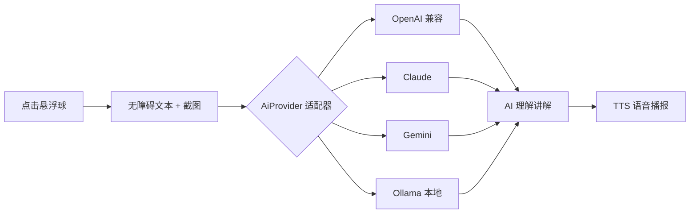
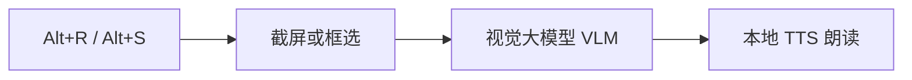

<div align="center">

# 万物皆可读 · Read Anything

**不是"念字"，而是 AI 看懂屏幕后，像朋友一样讲给你听。**

[](https://www.python.org/)
[](https://developer.android.com/)
[](https://kotlinlang.org/)
[](https://github.com/dhc979917-ux/read-anything)

*A screen-reading assistant that actually **understands** what's on your screen — and tells you, out loud, in plain language.*

</div>

---

## 这是什么

一个给**视障用户**、**视疲劳人群**和"懒得看字的人"的屏幕理解助手。

现有的读屏工具（NVDA、TalkBack）和 OCR 朗读工具做的都是**逐字念屏幕**；本项目把屏幕内容交给大语言模型，让它**理解之后讲解**：

> 屏幕上是一张购物订单页，你在"待发货"列表里有一单昨天 21:47 下的单，商品是蓝牙耳机，金额 199 元，页面底部有个"查看物流"按钮，如果你想看物流信息，点它就行。

核心设计原则：**不绑死任何 AI 厂商**。模型适配器架构，支持 4 类服务商、9 个预设，App 内随时切换、无需重新编译。

| 实现 | 技术栈 | 获取屏幕内容的方式 | 状态 |
|---|---|---|---|
| **Windows 桌面版** | Python + mss + VLM + pyttsx3 | 截屏 → 视觉大模型（图表、图片都能读） | ✅ 可运行 |
| **Android v0.2**（`MyReaderApp`） | Kotlin + 无障碍 + MediaProjection + LLM + TTS | **文本 + 截图双通道**，多模型适配器架构 | ✅ 可运行 |
| Android v0.1（`MyReaderDemo`） | Kotlin + 无障碍 + LLM + TTS | 纯文本，首个迭代，保留供参考 | ✅ 可运行 |

## 效果演示

> 📷 贡献欢迎：录一段 GIF 放到 `docs/` 下替换本节，比一百句话都有说服力。

（占位：Android 悬浮球点击 → 语音讲解截图 / Windows Alt+R 朗读视频）

## 工作原理

**Android v0.2**：点悬浮球 → 无障碍服务抓屏幕文本 + MediaProjection 截图 → 交给任意已配置的 AI（适配器模式）→ TTS 中文朗读。首次点球会请求屏幕录制授权，之后 AI 拿到的是"文字 + 画面"双输入，图片图表也能描述。



**Windows 版**：全局热键截屏 → 直接把**图片**发给视觉大模型（VLM）→ 朗读。



## 快速开始

### Android v0.2

1. 用 Android Studio 新建 `Empty Views Activity` 项目（包名必须为 **`com.example.myreader`**）
2. 把新项目文件夹拖到 **`一键拷贝到AndroidStudio项目.bat`** 上，自动拷入代码
3. 手机开 USB 调试、插线，点绿色 ▶ 运行
4. App 内：**设置 → 提供商选预设 → 填密钥 → 点「测试连接」验证 → 保存**
5. 开启无障碍服务 → 开悬浮球 → 去任意 App 点球听讲解（首次会请求屏幕录制授权）

### Windows 版

```bash
# 建议建虚拟环境后执行
pip install -r requirements.txt
```

1. 用记事本打开 `config.json`，填入 `api_key`（默认智谱 `glm-4v-flash`，免费）
2. 双击 `启动.bat`

| 热键 | 作用 |
|---|---|
| `Alt + R` | AI 理解整个屏幕并朗读 |
| `Alt + S` | 框选一块区域朗读（图表/图片/视频画面均可） |
| `Alt + Q` | 停止朗读 |

## 支持的 AI 服务商

Android v0.2 在 App 内「设置」里选预设，随时切换、无需重新编译，自带「测试连接」验证；Windows 版改 `config.json`。

| 服务商 | 协议 | 推荐模型 | 密钥 | 备注 |
|---|---|---|---|---|
| 智谱 AI | OpenAI 兼容 | `glm-4v` | 需要 | 国内直连 |
| 通义千问 | OpenAI 兼容 | `qwen-vl-plus` | 需要 | 国内直连，视觉模型 |
| DeepSeek | OpenAI 兼容 | `deepseek-chat` | 需要 | 国内直连，纯文本 |
| Kimi | OpenAI 兼容 | `moonshot-v1-8k-vision-preview` | 需要 | 国内直连 |
| OpenAI | OpenAI 兼容 | `gpt-4o-mini` | 需要 | 国内网络需代理 |
| Anthropic Claude | 原生协议 | `claude-3-5-sonnet` | 需要 | 专用适配器 |
| Google Gemini | 原生协议 | `gemini-1.5-pro` | 需要 | 专用适配器 |
| Ollama 本地 | 原生协议 | `llava` | **不需要** | 电脑跑模型，手机零流量 |

> 🔐 **隐私提示**：除本地模型外，屏幕文字和截图会发送到所配置的云端服务商。正式产品需要做脱敏、本地模型或用户授权处理，当前 Demo 未做。

## 多模型架构（适配器模式）

业务层只认识 `AiProvider` 接口，不知道任何具体厂商的存在：

```
MainActivity（业务） ──> AiProvider 接口 ──> OpenAiProvider / ClaudeProvider / GeminiProvider / OllamaProvider
                                              └─ 加新模型 = 加一个文件，不改业务代码
```

如何接入新服务商（含两类情况的做法）详见 [MyReaderApp/PROVIDERS.md](MyReaderApp/PROVIDERS.md)。

## 和现有工具的差异

| 工具 | 逐字念 | 理解讲解 | 能读图片图表 | 平台 |
|---|---|---|---|---|
| 系统读屏（NVDA / TalkBack） | ✅ | ❌ | ❌ | 桌面 / Android |
| OCR 朗读工具（read-screen 等） | ✅ | ❌ | ❌ | 各平台 |
| **万物皆可读** | ✅ | ✅ LLM 生成口语讲解 | ✅（Windows VLM / Android 截图+多模态） | Windows / Android |

调研过的同类先例见[参考项目](#参考项目)。

## 项目结构

```
├── read_screen.py            # Windows 版主程序（截屏 → VLM → 朗读）
├── config.json               # Windows 版 AI 配置
├── 启动.bat                   # Windows 版一键启动
├── 一键拷贝到AndroidStudio项目.bat  # Android 代码导入脚本（当前指向 v0.2）
├── MyReaderApp/              # Android v0.2（多模型 + 截图多模态）
│   ├── PROVIDERS.md          # 如何添加新 AI 提供商
│   └── app/src/main/java/com/example/myreader/
│       ├── MainActivity.kt       # 主界面 + 悬浮球 + 朗读流程
│       ├── SettingsActivity.kt   # 设置页：模式/权限/模型配置
│       ├── ReaderService.kt      # 无障碍服务：读屏幕（含操作预留接口）
│       ├── ScreenshotHelper.kt   # MediaProjection 截图
│       ├── MediaProjectionService.kt # 前台服务承载投影（Android 14 要求）
│       ├── Mode.kt               # 三模式 / 四级权限枚举
│       ├── TtsHelper.kt          # TTS 封装
│       └── ai/                   # 模型适配器层
│           ├── AiProvider.kt     # 统一接口
│           ├── AiProviderFactory.kt
│           ├── ModelConfig.kt / ModelConfigStore.kt
│           └── OpenAi / Claude / Gemini / Ollama Provider
└── MyReaderDemo/             # Android v0.1（首版，保留参考）
```

## 路线图

- [x] 多模型自由切换，不绑死 OpenAI（适配器架构 + 9 预设）
- [x] Android 支持截图 + 多模态模型（文字 + 画面双输入）
- [ ] Windows 版换 edge-tts 自然人声（当前 pyttsx3 音色较机械）
- [ ] 悬浮球长按菜单：停止 / 重读 / 切换模式
- [ ] 助手模式：关键场景主动提醒（架构已预留）
- [ ] 操作能力分级：点按钮 → 填表单 → 下单（1~3 级，接口已预留）
- [ ] 连续朗读模式：页面内容变化时自动重读
- [ ] 手机端本地小模型离线兜底（无网也能用）
- [ ] 长屏幕内容智能截断与摘要

## 常见问题

<details>
<summary>第一次点悬浮球弹了"屏幕录制"授权？</summary>

这是截图功能的正常流程（MediaProjection）。授权一次后会话内复用；不授权也能用，只是 AI 只读文字、看不到画面。
</details>

<details>
<summary>国产手机开了无障碍，过一会儿悬浮球就失灵？</summary>

系统 battery optimization 杀了后台。设置 → 电池 → 应用启动管理，把本应用设为"手动管理"并允许后台运行。
</details>

<details>
<summary>点了悬浮球没声音？</summary>

检查 设置 → 辅助功能 → 文本转语音（TTS），确认安装了中文语音包；模拟器自带的 Google TTS 常缺中文，建议真机测试。
</details>

<details>
<summary>提示"AI 调用失败"？</summary>

先在设置页点「测试连接」定位问题：多半是密钥错误或网络不通。国内网络建议选智谱/DeepSeek 预设；OpenAI 需要代理。错误信息会通过语音读出来，方便排查。
</details>

<details>
<summary>Windows 版报"识别失败"？</summary>

检查 `config.json` 的 `api_key` 是否已填写、网络能否访问所配服务商。
</details>

## 参考项目

本项目立项前调研过的同类开源项目，感谢先行者们：

- [read-screen](https://github.com/wangz-code/read-screen) / [screen-speak](https://github.com/Lekonidus/screen-speak) — 框选屏幕 OCR + 本地 TTS 朗读
- [ScreenGPT-OCR](https://github.com/Chiwai15/ScreenGPT-OCR) — 截图 + GPT-4o 理解 + TTS 的早期尝试
- [UGTLive](https://github.com/SethRobinson/UGTLive) — 屏幕实时翻译与朗读，工程完整度标杆
- [overlay-translator](https://github.com/ciddwd/overlay-translator) — Android 屏幕实时翻译（980 star），验证了需求

## 许可证

待定（建议 MIT，欢迎提建议）。

---

<div align="center">

**如果这个项目对你有帮助，欢迎点一个 Star ⭐**

</div>
